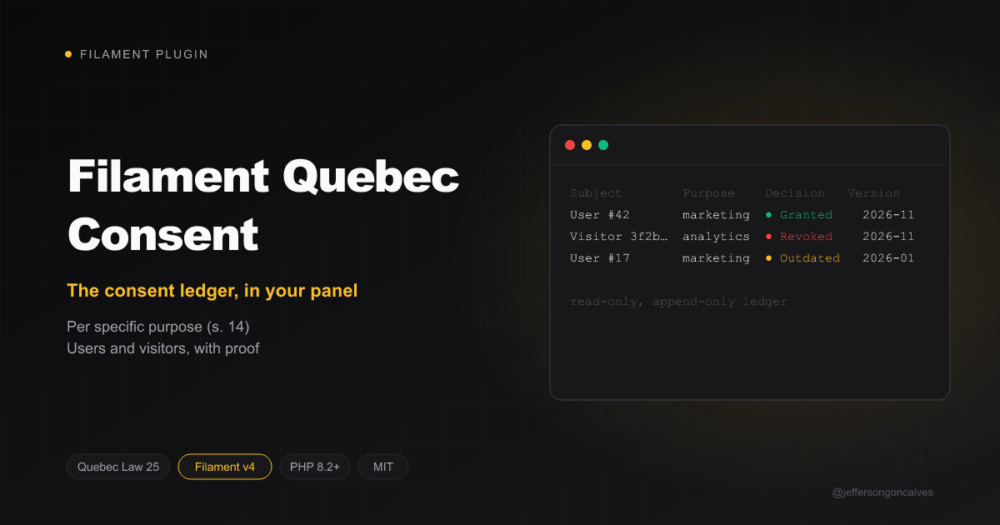

<div class="filament-hidden">



</div>

# Filament Quebec Consent

[](https://packagist.org/packages/jeffersongoncalves/filament-quebec-consent)
[](https://github.com/jeffersongoncalves/filament-quebec-consent/actions?query=workflow%3Atests+branch%3A2.x)
[](https://github.com/jeffersongoncalves/filament-quebec-consent/actions?query=workflow%3A"Fix+PHP+code+styling"+branch%3A2.x)
[](https://packagist.org/packages/jeffersongoncalves/filament-quebec-consent)
[](LICENSE.md)

Browse the consent ledger of [laravel-quebec-consent](https://github.com/jeffersongoncalves/laravel-quebec-consent) from your Filament panel. Each row is one consent decision. When you need to prove a consent, manifest, free, enlightened and given for a specific purpose under Quebec's private sector privacy act (Law 25) (s. 14), the record shows who decided, for which purpose and which version of the terms, when, from where (IP address, user agent, source), and its metadata.

## Features

- Consents of users and of visitors without an account (cookie banner).
- Filters by purpose, terms version, decision (granted or revoked) and visitors.
- Grants given for an older version of the terms are flagged: they no longer count as consent.
- Read-only, like the ledger itself: there is no create, edit or delete.
- 19 languages.

## Compatibility

| Plugin Version                                                              | Filament |
|-----------------------------------------------------------------------------|----------|
| [1.x](https://github.com/jeffersongoncalves/filament-quebec-consent/tree/1.x) | 3.x      |
| [2.x](https://github.com/jeffersongoncalves/filament-quebec-consent/tree/2.x) | 4.x      |
| [3.x](https://github.com/jeffersongoncalves/filament-quebec-consent/tree/3.x) | 5.x      |

## Installation

You can install the package via composer:

```bash
composer require jeffersongoncalves/filament-quebec-consent:"^2.0"
php artisan vendor:publish --tag="quebec-consent-migrations"
php artisan migrate
```

## Usage

```php
use JeffersonGoncalves\Filament\QuebecConsent\QuebecConsentPlugin;

public function panel(Panel $panel): Panel
{
    return $panel
        ->plugins([
            QuebecConsentPlugin::make()
                ->navigationGroup('Quebec')             // default: no group
                ->navigationSort(20)
                ->navigationIcon('heroicon-o-hand-thumb-up')
                ->slug('consents'),
        ]);
}
```

All fluent methods are optional. Purposes and their current terms version are configured in laravel-quebec-consent's `quebec-consent` config.

> The resource has no authorization of its own: register it only on panels whose users may see consent records, or add a policy for `JeffersonGoncalves\QuebecConsent\Models\ConsentRecord`.

## Related plugins

- [filament-quebec](https://github.com/jeffersongoncalves/filament-quebec): personal information inventory.
- [filament-quebec-requests](https://github.com/jeffersongoncalves/filament-quebec-requests): access, rectification, de-indexation and portability requests (ss. 27 to 32).

## Testing

```bash
composer test
```

## Changelog

Please see [CHANGELOG](CHANGELOG.md) for more information on what has changed recently.

## Contributing

Please see [CONTRIBUTING](.github/CONTRIBUTING.md) for details.

## Security Vulnerabilities

Please review [our security policy](../../security/policy) on how to report security vulnerabilities.

## Credits

- [Jefferson Gonçalves](https://github.com/jeffersongoncalves)
- [All Contributors](../../contributors)

## License

The MIT License (MIT). Please see [License File](LICENSE.md) for more information.
